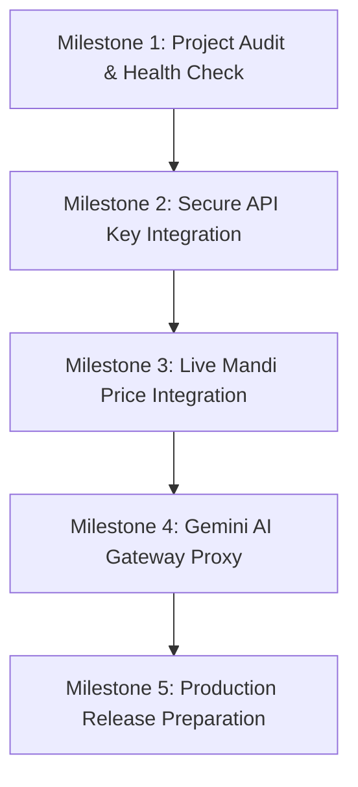

# IMPLEMENTATION PLAN: EcoSusRural Production Release

---

## 1. Roadmap & Phased Execution

### Milestone 1: Project Audit & Test Baseline (Completed)
- Verify Flutter 3.47.7 & Dart 3.13.5 environment.
- Confirm zero analyze errors (`flutter analyze`).
- Run 90 unit/widget tests with 100% pass rate.
- Document audit and system capabilities.

### Milestone 2: Backend Security Configuration (Active)
- Inject verified live Mandi API key (`579b464...`) into backend `.env`.
- Inject verified live Gemini API key (`AQ.Ab8RN6...`) into backend `.env`.
- Configure rate-limiting and proxy routes to insulate client from raw keys.

### Milestone 3: Live Mandi Price Service & UI Bridge
- Create `/api/mandi` proxy route in Express backend with in-memory caching (15 min TTL) to avoid hitting data.gov.in rate limits.
- Build Flutter repository connecting `MspSupportScreen` and `MandiImpactScreen` directly to live mandi prices.

### Milestone 4: Secure AI Assistant Gateway
- Configure Express AI Gateway (`/api/ai/answer`) to route requests to Google Gemini model when enabled.
- Ensure fallback to grounded local agricultural knowledge base when offline or rate-limited.

### Milestone 5: Quality Assurance & Play Store Readiness
- Verify app icons, splash screens, permissions in AndroidManifest.xml.
- Ensure all screen resolutions (phone, tablet, TV) render smoothly with ScreenUtil.
- Run complete end-to-end regression tests.
